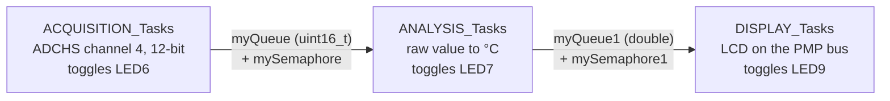

# PIC24/32 Real-Time Thermometer

A digital thermometer for Microchip PIC microcontrollers, built in three stages for a real-time operating systems lab (TP RT-Therm). It starts as a bare-metal PIC24 program and ends as a PIC32MZ application running on FreeRTOS with MPLAB Harmony v3.

| Version | MCU | Toolchain | Approach |
|---|---|---|---|
| [ThermoV1](ThermoV1/) | PIC24FJ1024GB610 | XC16 v2.10, MCC | Bare-metal super-loop, ADC interrupt, SPI EEPROM history |
| [ThermoV1.1](ThermoV1.1/) | PIC32MZ2048EFH100 | XC32 v4.60, Harmony v3 | First FreeRTOS port, three tasks |
| [ThermoV2](ThermoV2/) | PIC32MZ2048EFH100 | XC32 v4.60, Harmony v3 | FreeRTOS pipeline with queues and semaphores |

All projects were built with MPLAB X IDE v6 and flashed with the on-board PICkit (PKOB).

## ThermoV1: bare-metal PIC24

- The ADC interrupt sets a flag, and the main loop reads the sample and converts it to °C.
- A 16-character LCD shows a menu: **1. Real-time** (button on RD6) or **2. View history** (button on RD7).
- The last 10 readings are kept in a circular buffer. When the buffer wraps, they are written to an external SPI EEPROM (`eepromcommand.c`, chip select on RG0) and read back for the history screen.

## ThermoV2: FreeRTOS on PIC32MZ

The application is split into three Harmony tasks. Each stage passes its result to the next through a queue and signals it with a binary semaphore. Each stage also toggles an LED, so the pipeline can be watched on the board.



The conversion assumes an analog sensor with a 500 mV offset and 10 mV/°C, on a 3.3 V reference:

```
T(°C) = (raw × 3.3 / 4095 − 0.5) × 100
```

FreeRTOS settings (`ThermoV2/src/config/default/FreeRTOSConfig.h`): preemptive scheduler, 1 kHz tick, `heap_1` with a 28 000-byte heap, three tasks at priority 1 with 1024-word stacks.

ThermoV1.1 is the first version of this pipeline. There, the display task starts the ADC conversion and reads its queue without waiting on a semaphore.

## Repository layout

```
ThermoV1/ThermoV1.X/         MPLAB X project, application code and MCC drivers
ThermoV1.1/src/              Application tasks and Harmony/FreeRTOS config
ThermoV1.1/Thermo_V1.X/      MPLAB X project
ThermoV2/src/                Application tasks and Harmony/FreeRTOS config
ThermoV2/Thermo.X/           MPLAB X project and LCD driver (lcd.c, lcd.h)
TP_RT_Therm__Harmony_V3___FreeRTOS_.pdf   Lab report (in progress)
```

## Building

1. Install MPLAB X IDE v6, plus XC16 (for V1) or XC32 (for V1.1 and V2).
2. In MPLAB X, open the `.X` folder of the version you want.
3. Build and program the board.

To regenerate the drivers, open `Thermo.mc3` with MCC (V1) or the MCC Harmony content manager (V1.1 and V2).

## Opening the projects on another machine

The projects were developed on Windows under `D:/Microchip/`. The LCD driver was shared between versions by linking the files from the V1 project folder, not by copying them. After cloning:

- **ThermoV1.1**: the project links `lcd.c` and `lcd.h` from `D:/Microchip/Projet-Thermo-main/Thermo_v1.X/`. Remove those two entries in MPLAB X and add the LCD files from this repository.
- **ThermoV2**: `src/main.c` still includes `../Thermo.X/Lcd_print.h`, the old name of the LCD header. The driver is now `Thermo.X/lcd.c` and `lcd.h`, so point the include there.

## Notes

- **ThermoV1**: the conversion subtracts the 0.5 V sensor offset after scaling to °C instead of before, so readings are offset. V2 uses the corrected formula.

## History

The commit history starts from [Soriane-Charle/Thermometre-temps-Reel](https://github.com/Soriane-Charle/Thermometre-temps-Reel).
