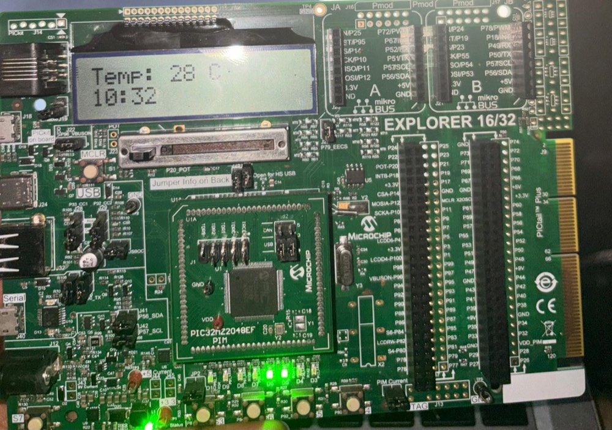
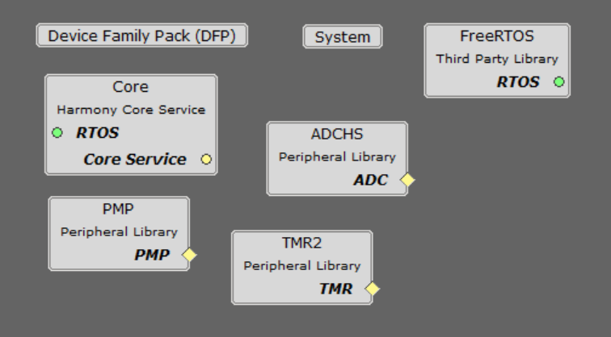
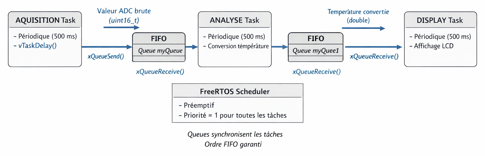
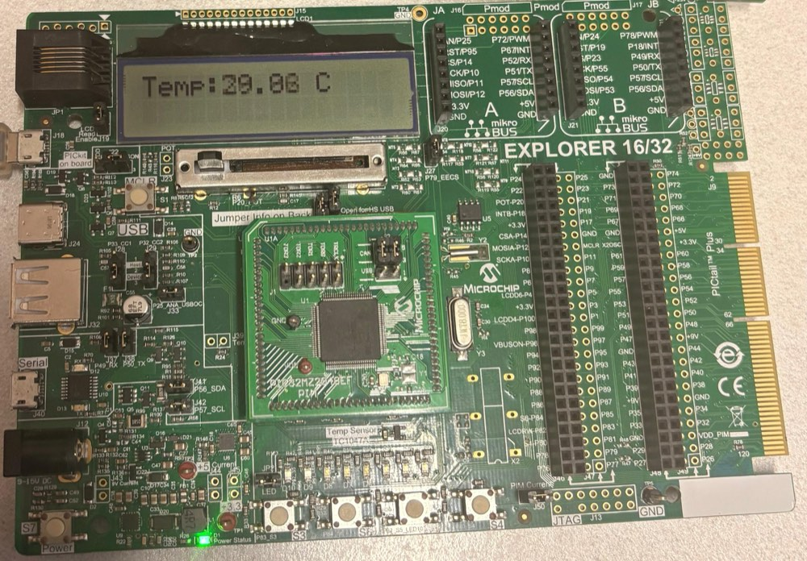
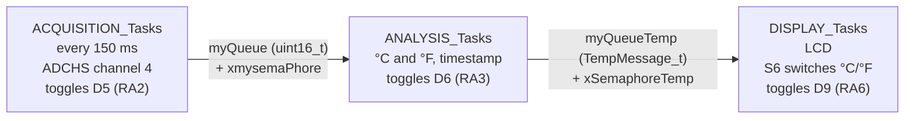

# PIC24/32 Real-Time Thermometer

A digital thermometer for Microchip PIC microcontrollers, built in three stages for a real-time operating systems lab (TP RT-Therm). It starts as a bare-metal PIC24 program and ends as a PIC32MZ application running on FreeRTOS with MPLAB Harmony v3.



| Version | MCU | Toolchain | Approach |
|---|---|---|---|
| [ThermoV1](ThermoV1/) | PIC24FJ1024GB610 | XC16 v2.10, MCC | Bare-metal super-loop, ADC interrupt, SPI EEPROM history |
| [ThermoV1.1](ThermoV1.1/) | PIC32MZ2048EFH100 | XC32 v4.60, Harmony v3 | RT-Therm V1: three periodic tasks linked by queues |
| [ThermoV2](ThermoV2/) | PIC32MZ2048EFH100 | XC32 v4.60, Harmony v3 | RT-Therm V2: one timed task, semaphores, °C/°F switch, timestamps |

All projects were built with MPLAB X IDE v6 and flashed with the on-board PICkit (PKOB) of the Explorer 16/32 board.

RT-Therm V1 and V2 are described in the lab report (in French): [TP_RT_Therm_Harmony_V3_AND_FreeRTOS.pdf](TP_RT_Therm_Harmony_V3_AND_FreeRTOS.pdf).

## ThermoV1: bare-metal PIC24

- ADC1 samples the temperature sensor (AN4) continuously. Its interrupt sets a flag, and the main loop reads the sample and converts it to tenths of a degree.
- A 16-character LCD shows a menu: **1. Real-time** (button on RD6) or **2. View history** (button on RD7).
- The last 10 readings are kept in a circular buffer, each with an RTCC timestamp (minutes:seconds). When the buffer wraps, the readings and timestamps are written to an external 25LC256 SPI EEPROM (`eepromcommand.c`, chip select on RG0). Each temperature takes 2 bytes, and each write waits for the EEPROM to finish.
- The history screen reads them back, oldest first, as `T1   24.8C 30:04` (reading number, °C, mm:ss).

## The FreeRTOS versions on PIC32MZ

Both are MPLAB Harmony v3 projects with the same components: FreeRTOS, the ADCHS converter for the TC1047A sensor, the PMP bus for the LCD and Timer 2 for the LCD's delays.



The temperature sensor gives 500 mV at 0 °C and 10 mV/°C; on the 12-bit ADC with a 3.3 V reference:

```
T(°C) = (raw × 3.3 / 4095 − 0.5) × 100
```

ThermoV1 uses the same formula with its 10-bit ADC, dividing by 1023 instead of 4095.

FreeRTOS settings (`src/config/default/FreeRTOSConfig.h`): preemptive scheduler, 1 kHz tick, `heap_1` with a 28 000-byte heap, three tasks at priority 1 with 4096-byte stacks.

### ThermoV1.1: RT-Therm V1

Three tasks run every 500 ms, each with its own `vTaskDelay`, and pass data through queues only, without semaphores. Acquisition sends the raw ADC value through `myQueue` and toggles D5 (RA2). Analysis converts it to °C, sends it through `myQueue1` and toggles D6 (RA3). Display toggles D9 (RA6) and shows a menu, or the temperature to 0.01 °C while S6 (RD13) is held.





The task code follows the report's figures 3.2 to 3.4. `DisplayMenu()`, whose code the report does not show, was written when this version was brought in line with the report. It was checked with XC32 v4.60 on a simulated Explorer 16/32, not yet on the board.

### ThermoV2: RT-Therm V2

Only the acquisition task is timed: Harmony runs it every 150 ms. It wakes the analysis task with a binary semaphore, which wakes the display task the same way, so analysis and display run only when there is a new measurement. Each task toggles an LED, so the pipeline can be watched on the board.



- Analysis sends one `TempMessage_t` per measurement (`src/temp_message.h`): the temperature in °C and in °F, the unit to show, and the time since start-up in seconds.
- The LCD shows `Temp: 28 C` on the first line and the time of the measurement as minutes:seconds on the second.
- Pressing S6 (RD13) switches between °C and °F without recomputing anything, since the message carries both. The new unit is kept for the next measurements; while S6 is held, the unit switches at every measurement.

The original source of this version was lost. It was rebuilt from the report: the acquisition and display code, the message structure and the Harmony settings follow figures 4.1 to 4.4, and the analysis task, `ToggleTempUnit()` and the LCD output follow the report's description and the photo above. The rebuild was checked with XC32 v4.60 on a simulated Explorer 16/32, not yet on the board.

## Repository layout

```
ThermoV1/ThermoV1.X/         MPLAB X project, application code, PIC24 LCD driver, MCC drivers
ThermoV1/rapportPIC24MAMBO_MOTSOU_JUNIOR.pdf   PIC24 (V1) report
ThermoV1.1/src/              Application tasks and Harmony/FreeRTOS config
ThermoV1.1/Thermo_V1.X/      MPLAB X project and PIC32 LCD driver (lcd.c, lcd.h)
ThermoV2/src/                Application tasks, temp_message.h and Harmony/FreeRTOS config
ThermoV2/Thermo.X/           MPLAB X project and PIC32 LCD driver (lcd.c, lcd.h)
TP_RT_Therm_Harmony_V3_AND_FreeRTOS.pdf   FreeRTOS lab report (French)
docs/images/                 Figures and photos from the report
```

## Building

1. Install MPLAB X IDE v6, plus XC16 (for V1) or XC32 (for V1.1 and V2).
2. In MPLAB X, open the `.X` folder of the version you want.
3. Build and program the board.

To regenerate the drivers, open `Thermo.mc3` with MCC (V1) or the MCC Harmony content manager (V1.1 and V2).

## Notes

- **LCD drivers**: V1 has its own PIC24 driver (EPMP). V1.1 and V2 each have a copy of the PIC32 driver (PMP + Timer 2); V2's prints a `TempMessage_t`. The projects were first developed on Windows, where V1.1 linked its driver from another project by an absolute `D:/Microchip/...` path.
